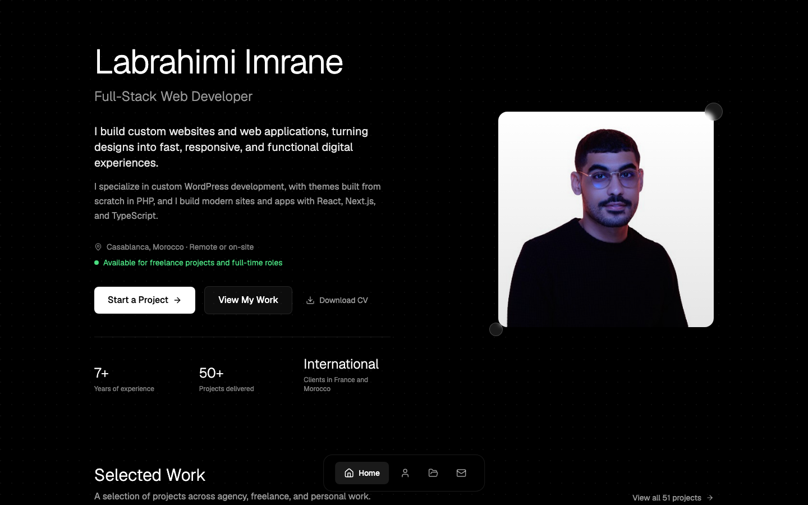
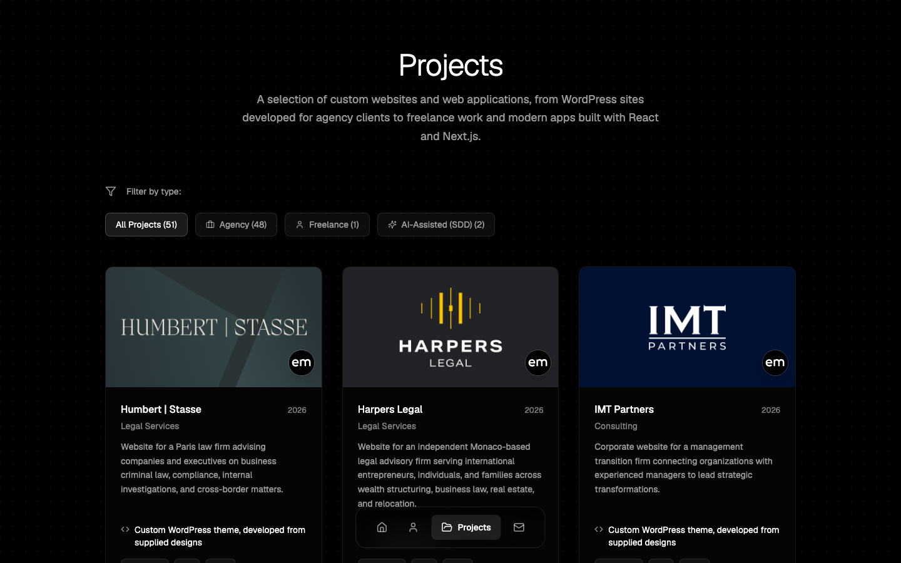
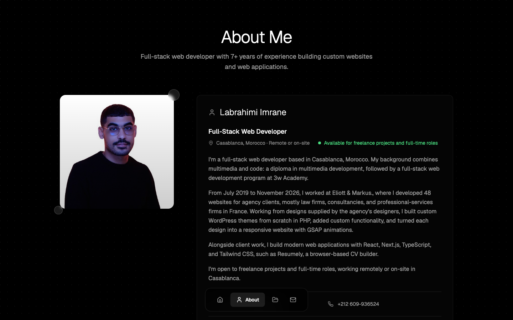
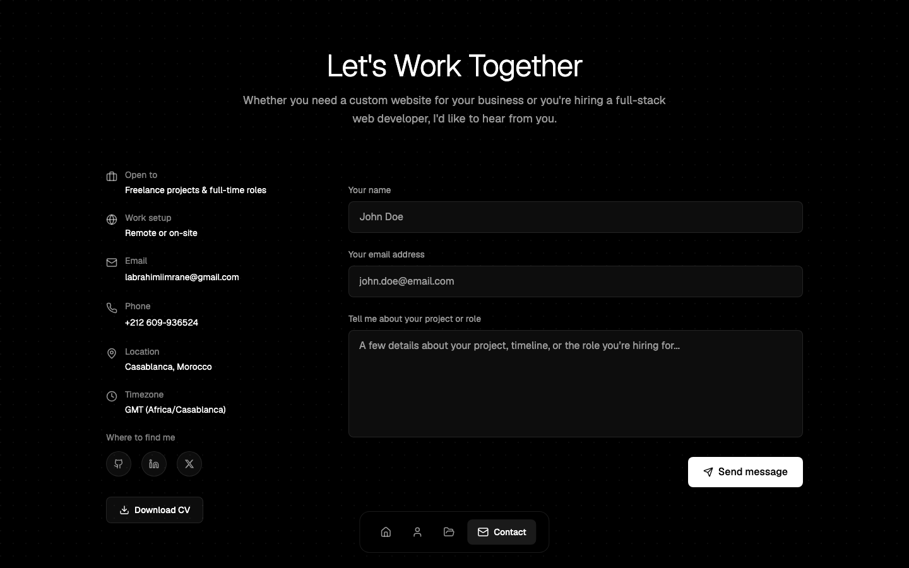
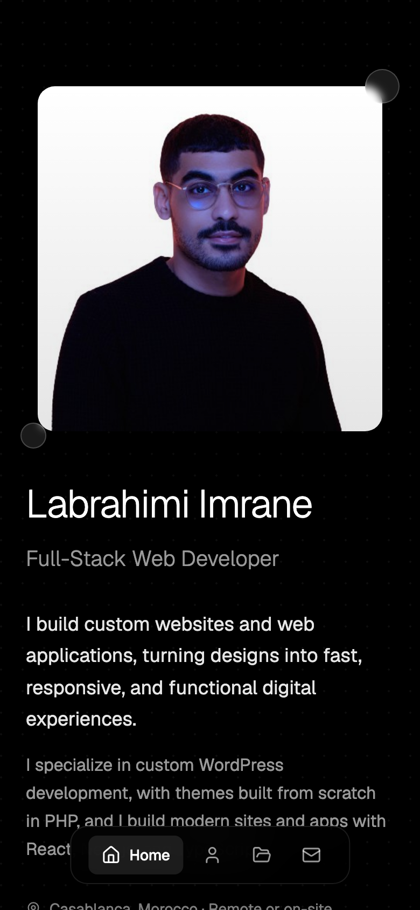
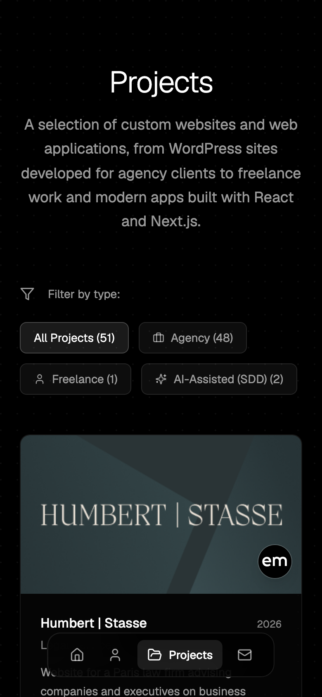

# Labrahimi Imrane — Portfolio

Personal portfolio website of **Labrahimi Imrane**, a full-stack web developer based in Casablanca, Morocco.

**Live site:** [imranelabrahimi.me](https://imranelabrahimi.me)



## About the project

This website presents my professional work to potential clients and employers. It showcases 50+ projects, most of them custom WordPress websites I developed for agency clients at Eliott & Markus., alongside freelance work and web applications built with React and Next.js.

The site is built to:

- **Show the work:** every project with its context, my role, the technologies used, and a link to the live site.
- **Tell the story:** experience, skills and education on a single About page.
- **Make contact easy:** clear calls to action, a downloadable CV, and a contact form that delivers messages straight to my inbox.

All portfolio content lives in a single file, [`lib/data.ts`](lib/data.ts), so updating the site never requires touching page components.

## Key features

### Content and presentation
- **Data-driven pages:** profile, experience, skills, education and projects all come from `lib/data.ts`.
- **Selected work on the home page:** projects flagged `featured: true` are highlighted automatically.
- **Filterable project archive:** filter projects by type (Agency, Freelance, AI-Assisted, Side Project), with live counts.
- **Informative project cards:** client context, a "what I built" line, key technologies, and links to the live site and source code.
- **Project type icons:** a 40×40 circular icon on each card identifies the project type, with an accessible label.
- **Proof points:** years of experience, project count (calculated from the data) and client reach.
- **CV download** from the home, about and contact pages.

### Contact form
- Sends messages by email through a Next.js API route and Nodemailer (Gmail).
- Server-side validation of required fields, email format and field lengths.
- User input is HTML-escaped before it is inserted into the email.
- Honeypot field for spam protection.
- Clear success and error messages, announced to screen readers.

### SEO
- Unique title, description and canonical URL for every page.
- Open Graph and X/Twitter cards with a share image generated at build time.
- `sitemap.xml` and `robots.txt` generated by Next.js.
- `Person` structured data (JSON-LD) on the home page.
- Favicon, Apple touch icon and theme color.

### Accessibility
- Semantic landmarks, a single `h1` per page and a correct heading hierarchy.
- "Skip to content" link and visible keyboard focus styles.
- Accessible names on all icon-only links and buttons.
- Text colors meet WCAG AA contrast on the dark background.
- Animations are disabled for users who prefer reduced motion.

### Responsive design
- Mobile-first layouts tested from 320px phones to large desktops.
- Floating dock navigation that adapts to small screens.
- Project links always visible, including on touch devices.

## Technologies

| Area | Technology |
| --- | --- |
| Framework | [Next.js 14](https://nextjs.org/) (App Router, static generation) |
| UI library | [React 18](https://react.dev/) |
| Language | [TypeScript 5](https://www.typescriptlang.org/) |
| Styling | [Tailwind CSS 3](https://tailwindcss.com/) + CSS design tokens |
| Font | [Geist](https://vercel.com/font) |
| Icons | [Lucide](https://lucide.dev/) |
| Email | [Nodemailer](https://nodemailer.com/) (Gmail SMTP) |
| Social images | `next/og` (`ImageResponse`) |
| Linting | ESLint with `eslint-config-next` |
| Hosting | [Vercel](https://vercel.com/) |

## Screenshots

### Desktop

| Home | Projects |
| --- | --- |
|  |  |

| About | Contact |
| --- | --- |
|  |  |

### Mobile

| Home | Projects |
| --- | --- |
|  |  |

> Screenshots live in [`docs/screenshots/`](docs/screenshots/). Replace a file with one of the same name to update it here.

## Getting started

### Requirements

- Node.js 18.17 or later
- npm (the project uses `package-lock.json`)

### Installation

```bash
git clone https://github.com/labrahimiimrane/labrahimi.me.git
cd labrahimi.me
npm install
npm run dev
```

Then open [http://localhost:3000](http://localhost:3000).

### Environment variables

Create a `.env.local` file in the project root (it is git-ignored):

```bash
# Gmail account that sends and receives contact form messages.
# GMAIL_PASS must be a Google App Password, not the account password.
GMAIL_USER=you@gmail.com
GMAIL_PASS=your-app-password

# Optional: production URL used for canonical links, the sitemap and social previews.
# Defaults to https://imranelabrahimi.me
NEXT_PUBLIC_SITE_URL=https://imranelabrahimi.me
```

Without the Gmail variables the site still works, but the contact form replies that it is temporarily unavailable.

### Scripts

| Command | Description |
| --- | --- |
| `npm run dev` | Start the development server |
| `npm run build` | Create a production build (fails on type or lint errors) |
| `npm run start` | Serve the production build |
| `npm run lint` | Run ESLint |
| `npm run typecheck` | Run the TypeScript compiler without emitting files |

## Project structure

```
app/
  layout.tsx              Root layout: font, site-wide metadata, skip link, navigation
  page.tsx                Home: hero, calls to action, proof points, selected work
  about/page.tsx          Bio, skills, experience, education
  projects/page.tsx       Project archive with type filters
  contact/page.tsx        Availability, contact details, CV download, contact form
  api/contact/route.tsx   POST endpoint: validates the form and sends the email
  opengraph-image.tsx     Social share card, generated at build time
  twitter-image.tsx       Same card for X/Twitter
  sitemap.ts              /sitemap.xml
  robots.ts               /robots.txt
  icon.png, apple-icon.png, favicon.ico
  globals.css             Design tokens (CSS variables) and shared styles
components/
  navigation.tsx          Floating bottom "dock" navigation
  project-card.tsx        Project card shared by the home and projects pages
  project-type-badge.tsx  40×40 project type icon
  projects-filter.tsx     Project type filter (client component)
  contact-form.tsx        Contact form with honeypot (client component)
  social-links.tsx        GitHub / LinkedIn / X links
  icons/x-icon.tsx        X (Twitter) logo
lib/
  data.ts                 All portfolio content and its TypeScript types
  project-types.ts        Labels and default role for each project type
  site.ts                 Site URL, default metadata and the page-metadata helper
public/
  avatar.jpeg             Profile photo
  imrane-labrahimi-cv.pdf Downloadable CV
  placeholder.svg         Fallback image for projects without one
  projects/               Project images (360×240 PNG)
docs/
  screenshots/            Screenshots used in this README
```

## Updating content

Everything visitors read comes from [`lib/data.ts`](lib/data.ts):

| Export | Content |
| --- | --- |
| `personalInfo` | Name, title, intro text, bio, availability, years of experience, avatar and CV path |
| `experience` | Work history, with optional `highlights` bullet points |
| `education` | Degrees and training |
| `skills` | Labelled skill groups shown on the About page |
| `projects` | All projects (see below) |
| `proofPoints` | Home page proof points (the project count is calculated automatically) |
| `socialLinks`, `contactInfo` | Social profiles and contact details |

### Adding a project

1. Add a **360×240** image to `public/projects/` (lowercase file name).
2. Add an entry to `projects` in `lib/data.ts`:

```ts
{
  id: 53,                              // unique: next number after the last project
  title: "Project name",
  description: "What the client or project needed, in one or two sentences.",
  image: "/projects/my-project.png",   // leading slash; "" shows the placeholder
  category: "Legal Services",
  year: "2026",
  type: "agency",                      // "agency" | "freelance" | "sideprojects" | "ai-assisted-sdd"
  // role: "…",                        // optional; overrides the default role for the type
  technologies: ["WordPress", "PHP", "GSAP"],
  featured: false,                     // true shows it in Selected Work on the home page
  live: "https://example.com",         // "" hides the link
  github: "",                          // "" hides the link
},
```

Projects are sorted by year automatically. Cards hide the baseline HTML5 / CSS3 / JavaScript tags when more specific technologies are listed.

### Project types

| Type | Label | Default role shown on cards |
| --- | --- | --- |
| `agency` | Agency | Custom WordPress theme, developed from supplied designs |
| `freelance` | Freelance | Custom WordPress theme, developed from supplied designs |
| `sideprojects` | Side Project | Personal web application |
| `ai-assisted-sdd` | AI-Assisted (SDD) | Built using AI-assisted Spec-Driven Development |

Labels and default roles are defined in [`lib/project-types.ts`](lib/project-types.ts); the card icons are in [`components/project-type-badge.tsx`](components/project-type-badge.tsx).

## Design system

- **Dark theme only.** Colors are CSS variables in [`app/globals.css`](app/globals.css) (`--text-primary`, `--text-muted`, `--text-subtle`, `--border-color`, …), exposed to Tailwind as `text-primary`, `text-muted`, `text-subtle` and `border-border`.
- **Shared classes:** `.dot-grid` (page background), `.minimal-card` (glass card), `.dock` / `.dock-item` (navigation).
- **Typography:** Geist, with light-weight headings.

## Deployment

The site is deployed on **Vercel**. Pushing to `main` triggers a production deployment.

Set `GMAIL_USER`, `GMAIL_PASS` and, if needed, `NEXT_PUBLIC_SITE_URL` in the Vercel project's environment variables.

## Contact

- **Website:** [imranelabrahimi.me](https://imranelabrahimi.me)
- **Email:** [labrahimiimrane@gmail.com](mailto:labrahimiimrane@gmail.com)
- **LinkedIn:** [imrane-labrahimi](https://www.linkedin.com/in/imrane-labrahimi/)
- **GitHub:** [labrahimiimrane](https://github.com/labrahimiimrane)
